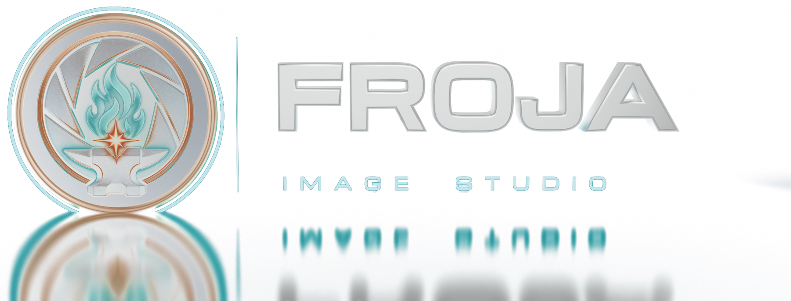
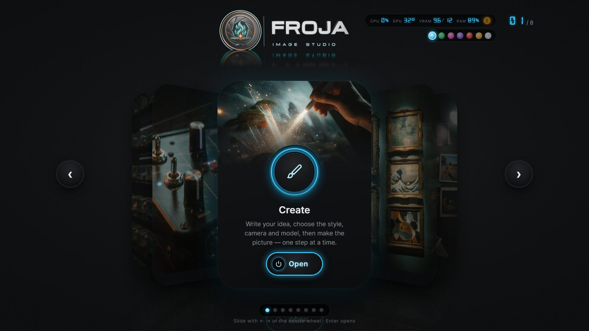
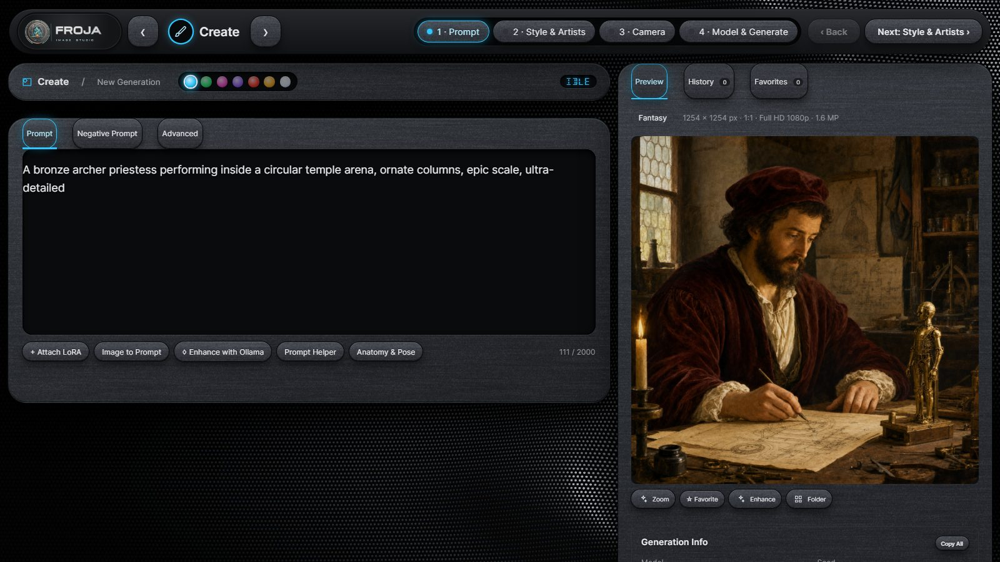
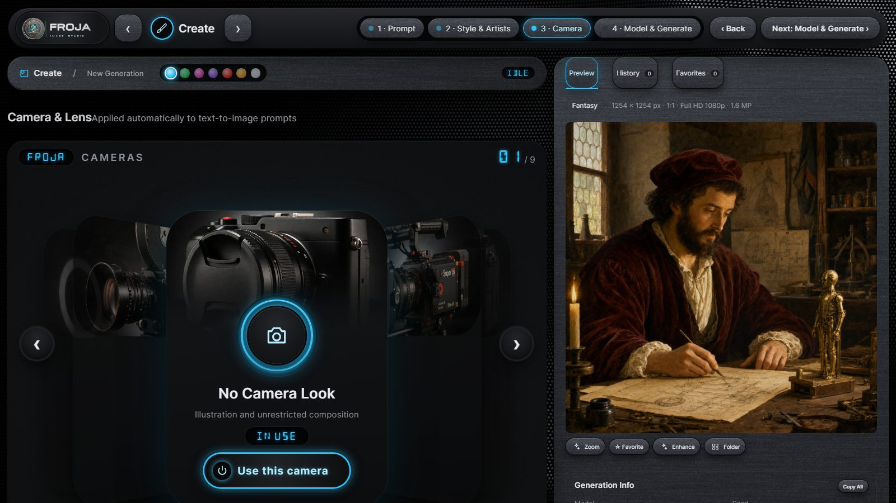
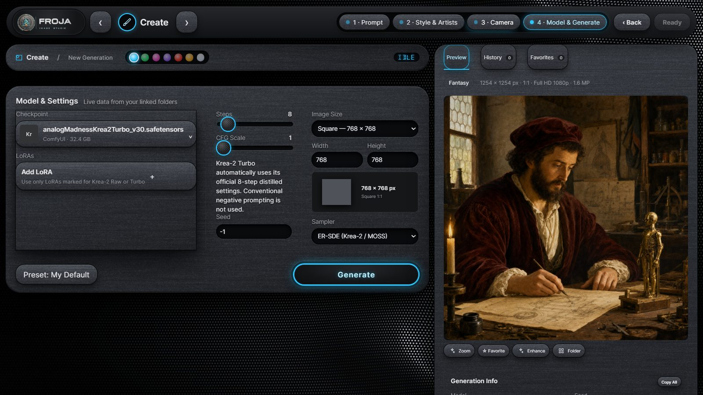
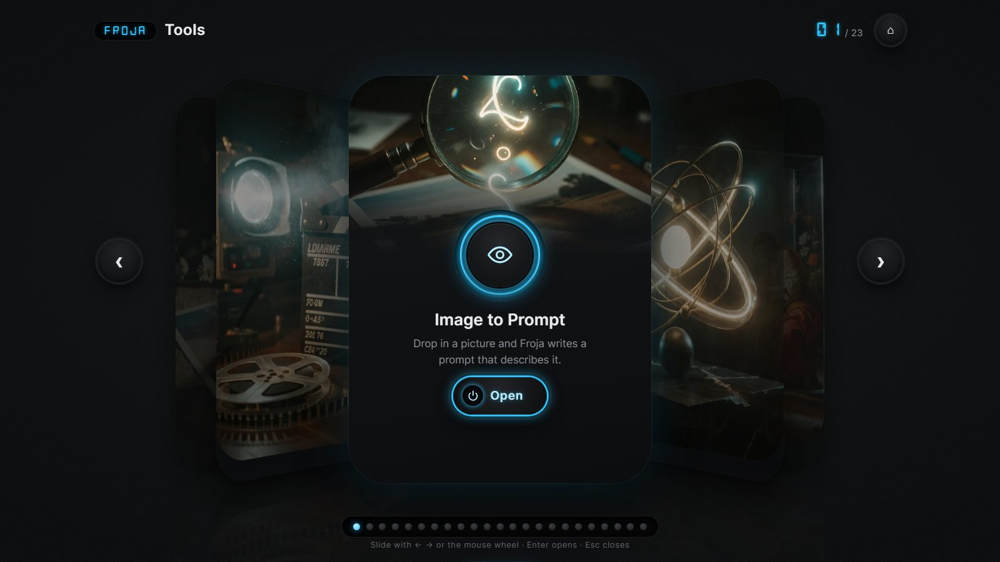
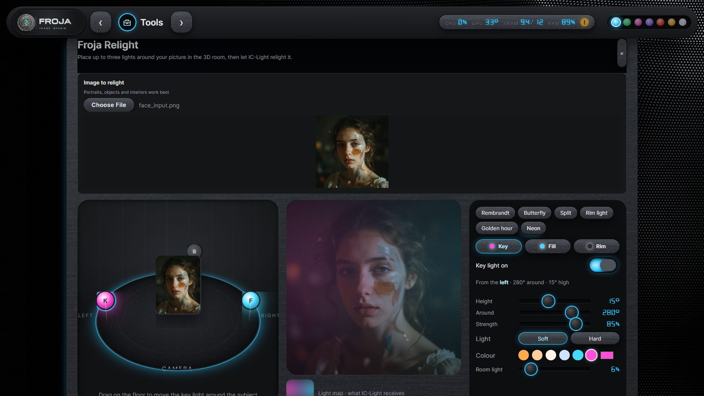
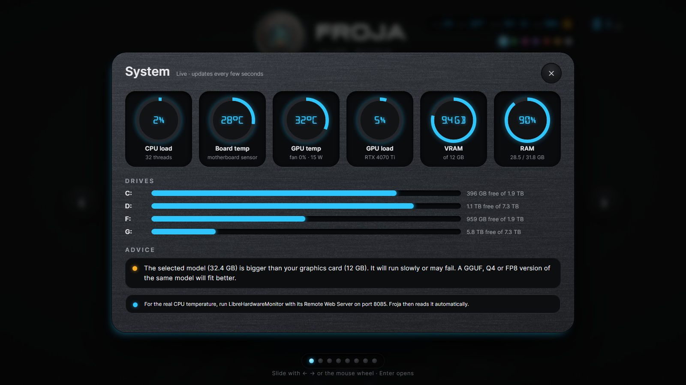
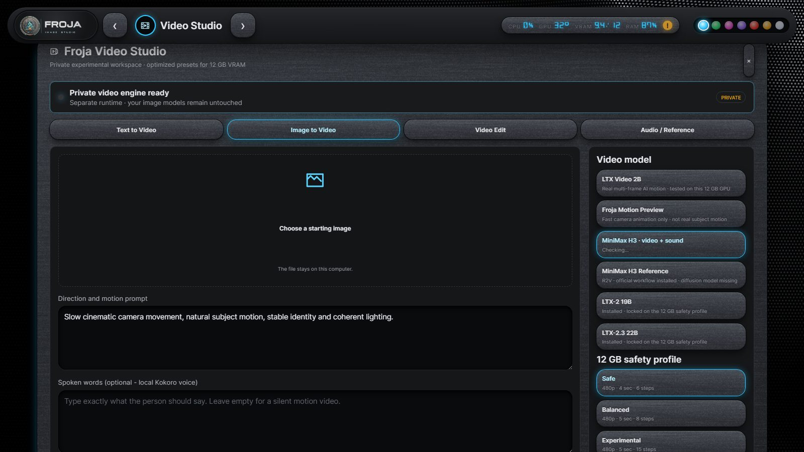
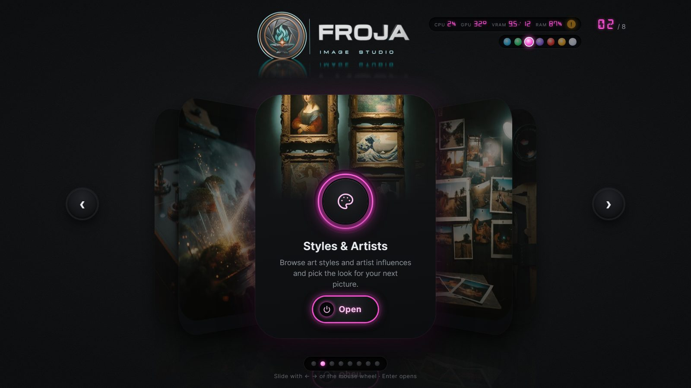

# Froja Image Studio

<p align="center">
  
</p>

<p align="center">
  A local-first image and video studio for ComfyUI and Ollama — every studio is a slide, every control glows like a real LED.
</p>

<p align="center">
  <strong>Create step by step · Styles &amp; Artists · Cameras · 23 tools · 3D Relight room · Video with sound · Training · System monitor</strong>
</p>

> **Project status:** active work in progress. The main generation workflow is usable today; some advanced workflows are experimental and depend on the ComfyUI nodes and models installed on your computer.



## What's new in 0.2

- **Everything is a slide.** Froja opens on a slider of studios — Create, Styles &amp; Artists, My Pictures, Tools, Video, Training, Models &amp; LoRAs and Settings. Slide with the arrows, the mouse wheel or the keyboard, press the glowing power button and you go inside.
- **Create in four steps:** 1 · Prompt → 2 · Style &amp; Artists → 3 · Camera → 4 · Model &amp; Generate, with your picture always visible.
- **Cameras as real product photos** (cinema, portrait 85 mm, medium format, wide, street, telephoto, macro, vintage anamorphic) — Froja photographed them itself.
- **Tools slider** with 23 tools, each with its own cover picture and glowing symbol.
- **3D Relight room:** place up to three lights (Key, Fill, Rim) around your picture, choose height, strength, colour and soft/hard light, or start from a preset (Rembrandt, Butterfly, Split, Rim, Golden hour, Neon). Froja turns the lights into a light map for IC-Light, so the light lands where you put it.
- **One look, many lights:** a black graphite design with brushed metal and LED details; pick the LED colour — ice blue, green, pink, purple, red, amber or white.
- **System monitor:** CPU, GPU temperature, VRAM, RAM and drives as live LED read-outs, with plain-language advice (for example when a model is too big for your graphics card or RAM is nearly full).
- **Picture sizes with names** (HD 720p, Full HD 1080p, Stories/Reels, Instagram square…) and the real size of every finished picture.
- **Optional MiniMax H3 video with sound** for strong graphics cards (see below).
- **Ollama steps aside** before a picture or video is made, so its models do not compete for graphics memory.

| | |
|---|---|
|  |  |
|  |  |
|  |  |
|  |  |

## Why Froja?

Froja brings common generative-image tasks into one clean interface while leaving model ownership with you. It indexes your existing model folders instead of duplicating multi-gigabyte files. Your prompts, images, models and Ollama conversations stay on your computer.

### Everything Froja can do

- Local text-to-image generation through ComfyUI (Krea-2, Flux, SDXL, Z-Image, MiniMax H3 Image and more).
- Checkpoint, LoRA, VAE and embedding discovery from configurable folders, with previews and trigger words.
- Prompt enhancement, prompt helper, image-to-prompt and multi-reference prompts with Ollama.
- Styles &amp; artist influences, camera looks, picture sizes with familiar names.
- Image enhancement, image-to-image, inpainting, ControlNet, face tools, repair, smart edit, character &amp; object transformer.
- 3D Relight room for IC-Light.
- Variation Lab, Prompt Batch, Reference Composer, Sketch &amp; 3D, Portrait Transformer, LoRA dataset and training studios.
- Froja Training Studio for controlled eight-view LoRA datasets, with full-quality inspection, zoom and approval controls.
- Appearance Library with realistic materials, body, hair, hands, landscape and fabric references.
- Prompt Cards and reusable custom wildcards for repeatable training combinations.
- Video Studio (local LTX, optional MiniMax H3 with sound).
- History and Favorites with generation metadata and zoom.
- Coordinated memory hand-off between isolated ComfyUI engines and Ollama.

## Install Froja — the easy way (Windows)

1. Download **[FROJA_INSTALLER.bat](https://github.com/debattistacliff-commits/Froja-Image-Studio/releases/latest/download/FROJA_INSTALLER.bat)** from the latest release.
2. Double-click it and answer a few simple questions.

The installer:
- asks where to put Froja (default: your user folder),
- checks Node.js and Python and offers to install them for you (it always asks first),
- downloads the latest Froja from GitHub and prepares it,
- connects your ComfyUI if you paste its folder (or lets you skip it for now),
- offers Ollama for prompt help and Image to Prompt (optional),
- adds a **Froja Image Studio** shortcut with the Froja icon to your desktop and Start menu,
- and starts Froja.

Running it again later updates Froja and keeps your settings.

## Launch Froja

- **Double-click `START_FROJA.bat`** — the window shows Froja's activity; keep it open while you work.
- Or **double-click `LAUNCH_FROJA.vbs`** — the same, started for you.
- **Desktop shortcut with the Froja icon:** right-click `INSTALL_SHORTCUTS.ps1` → *Run with PowerShell*. It adds *Froja Image Studio* to your desktop and Start menu.

Froja opens in your browser at `http://127.0.0.1:3310`. The launcher reads the path of your ComfyUI Python from `config/config.local.json` (`comfy_python`), so it works wherever ComfyUI is installed.

## Requirements

- Windows 10/11 or a modern Linux distribution.
- Python 3.10 or newer.
- Node.js 22 or newer.
- A working ComfyUI installation.
- NVIDIA GPU recommended. Advanced workflows have higher VRAM requirements.
- Optional: [Ollama](https://ollama.com/) for prompt tools and image recognition.
- Optional: a separate JoyAI-compatible ComfyUI installation for Smart Edit.

Froja does **not** download checkpoints or LoRAs automatically and does not include copyrighted model weights.

## Quick start — Windows

1. Download the Windows ZIP from the GitHub Releases page and extract it.
2. Double-click `SETUP_WINDOWS.bat`.
3. Open `config/config.local.json` and enter the path to your ComfyUI installation.
4. Double-click `START_FROJA.bat`.
5. Open `http://127.0.0.1:3310` if the browser does not open automatically.

Developer installation:

```powershell
git clone https://github.com/debattistacliff-commits/Froja-Image-Studio.git
cd Froja-Image-Studio
.\SETUP_WINDOWS.bat
```

## Quick start — Linux

On Ubuntu or Debian, install the system prerequisites first:

```bash
sudo apt update
sudo apt install python3 python3-venv python3-pip curl
```

Install Node.js 22 or newer using the instructions for your distribution, then run:

```bash
git clone https://github.com/debattistacliff-commits/Froja-Image-Studio.git
cd Froja-Image-Studio
chmod +x setup-linux.sh start-froja.sh
./setup-linux.sh
```

Edit `config/config.local.json`, then launch:

```bash
./start-froja.sh
```

## Connect Froja to ComfyUI

Copy `config/config.example.json` to `config/config.local.json`. The local file is ignored by Git and is never uploaded.

```json
{
  "comfy_root": "C:/AI/ComfyUI",
  "comfy_url": "http://127.0.0.1:9000",
  "model_roots": {
    "checkpoints": ["C:/AI/ComfyUI/models/checkpoints"],
    "loras": ["C:/AI/ComfyUI/models/loras"],
    "vae": ["C:/AI/ComfyUI/models/vae"],
    "embeddings": ["C:/AI/ComfyUI/models/embeddings"]
  },
  "diffusion_models_root": "C:/AI/ComfyUI/models/diffusion_models"
}
```

Use forward slashes in JSON paths on Windows. Froja can start ComfyUI from its `.venv`, or connect to an engine already running at `comfy_url`.

If models live outside ComfyUI, add those folders to `model_roots` and make them visible to ComfyUI through its `extra_model_paths.yaml`. Set `extra_model_paths_config` to that YAML file.

## Where models go

| Asset | Standard ComfyUI folder |
|---|---|
| Checkpoints | `ComfyUI/models/checkpoints/` |
| LoRAs | `ComfyUI/models/loras/` |
| VAEs | `ComfyUI/models/vae/` |
| Embeddings | `ComfyUI/models/embeddings/` |
| Diffusion models / UNets | `ComfyUI/models/diffusion_models/` |
| Text encoders | `ComfyUI/models/text_encoders/` |
| ControlNet | `ComfyUI/models/controlnet/` |

Preview images can sit beside a model using names such as `model.preview.png`, `model.png`, or `model.jpg`. LoRA metadata may be read from neighboring `.json` or `.txt` files.

## Connect Ollama

Install Ollama, then pull the default writing and vision models:

```bash
ollama pull qwen3.5:4b
ollama pull qwen3-vl:4b
```

Ollama normally listens at `http://127.0.0.1:11434`. Change `ollama_url` in `config.local.json` if yours uses another address.

- **Enhance with Ollama** rewrites a short idea as a production prompt.
- **Image to Prompt** analyzes an uploaded image with the vision model and polishes the result with the writing model.

## Z-Image Turbo and Krea-2

Froja includes workflow builders for these architectures, but users must obtain compatible weights legally and install their required text encoders, VAEs, and ComfyUI nodes. Filenames and node availability vary between releases; see [docs/MODELS.md](docs/MODELS.md).

## Optional: MiniMax H3 video (video with sound)

Froja's Video Studio can make short videos **with sound** from a text prompt or a starting picture using MiniMax H3. It is **switched off by default**, because video is heavy work for a graphics card.

| Graphics card | What Froja allows |
| --- | --- |
| 24 GB or more | Recommended: up to about 5 seconds, larger size |
| 16 GB | Works well: up to about 4 seconds |
| 12 GB | Safe mode: about 3 seconds, small size, roughly 7 minutes per clip (tested on an RTX 4070 Ti) |
| less than 12 GB | Not supported |

To use it:

1. Follow the official [MiniMax-H3 tutorial](https://docs.comfy.org/tutorials/video/minimax/minimax-h3) and put these files in your ComfyUI `models` folder:
   - `diffusion_models/minimax_h3_fl2va_pruned_int8_convrot.safetensors`
   - `text_encoders/qwen3vl_32b_minimax_h3_nvfp4_awq.safetensors`
   - `vae/minimax_h3_video_vae_fp16.safetensors` and `vae/minimax_h3_audio_vae_fp32.safetensors`
2. Install the turbo node and LoRA (needed for 12–16 GB cards):
   - `git clone https://github.com/larryvrh/ComfyUI-MiniMax-H3-Turbo` into `ComfyUI/custom_nodes`
   - `loras/minimax_h3_turbo_v4_step600_ema.safetensors` from [MiniMax-H3-Turbo-Lora](https://huggingface.co/larryvrh/MiniMax-H3-Turbo-Lora)
3. In Froja open **Video Studio**, choose **MiniMax H3 · video + sound** and switch it on. Froja checks the files and your graphics card and tells you in plain words what it can do.

Froja starts the MiniMax engine only for a job (on port 9020, set `minimax_video_url` in `config/config.local.json` to change it), frees memory from the picture engines first, makes one clip at a time, and stops the video engine again afterwards.

## Privacy and model safety

- Froja binds to `127.0.0.1` by default.
- Model files remain in user-selected folders.
- History and Favorites are stored locally in the browser profile.
- Generated images remain in the configured ComfyUI output directory.
- Public packages contain no checkpoints, LoRAs, embeddings, VAEs, user prompts, histories, or generated output.

## Development

```bash
npm install
python -m pip install -r requirements.txt
npm run dev
```

Release checks:

```bash
npm run lint
npx tsc --noEmit
npm test
```

## Collaboration

Ideas, testing, documentation, translations, UI improvements, workflow adapters, and bug fixes are welcome. Please read [CONTRIBUTING.md](CONTRIBUTING.md) and the [roadmap](ROADMAP.md).

- Use **Discussions** for ideas and design suggestions.
- Use **Issues** for reproducible bugs and feature proposals.
- Use **Pull Requests** for reviewed code contributions.
- Never upload proprietary model weights, personal images, tokens, or machine-specific configuration.

## Acknowledgements

Froja integrates with independent open-source projects including ComfyUI and Ollama. Their names and trademarks belong to their respective owners. Froja is not affiliated with Civitai, Stability AI, ComfyUI, Ollama, Krea, or the creators of third-party models and nodes.

## License

Froja Image Studio source code is released under the [MIT License](LICENSE). Model weights, preview images, third-party nodes, and generated content may have separate licenses and are not covered by Froja's license.
